# Workflow State Machine

```mermaid
stateDiagram-v2
    [*] --> PLANNING
    PLANNING --> DEVELOPING_PLAN
    DEVELOPING_PLAN --> REVIEWING_PLAN

    REVIEWING_PLAN --> IMPLEMENTING: PLAN_STATUS: APPROVED
    REVIEWING_PLAN --> DEVELOPING_PLAN: rejected; retries remain
    REVIEWING_PLAN --> WAITING_FOR_OWNER: rejected; retries exhausted

    IMPLEMENTING --> TESTING
    TESTING --> REVIEWING_CODE: QA_STATUS: PASSED
    TESTING --> IMPLEMENTING: QA_STATUS: FAILED
    REVIEWING_CODE --> COMPLETED: approved; delivery pending
    COMPLETED --> COMPLETED: deliver confirmed and merged
    REVIEWING_CODE --> IMPLEMENTING: revise
    REVIEWING_CODE --> WAITING_FOR_OWNER: rejected; retries exhausted

    WAITING_FOR_OWNER --> IMPLEMENTING: plan approved / code review passed
    WAITING_FOR_OWNER --> DEVELOPING_PLAN: plan revised
    WAITING_FOR_OWNER --> IMPLEMENTING: code revised
    WAITING_FOR_OWNER --> FAILED: rejected
```

Rules:

- The shared model router only calls models and selects fallbacks.
- Only IMPLEMENTING requires file-marker blocks.
- Manager tasks must modify project files; planning and inspection are not implementation tasks.
- A rejected plan never enters IMPLEMENTING automatically.
- Reviewer approval does not merge changes. A Git preview must be explicitly confirmed with `deliver --confirm <token>`; a changed preview requires a new confirmation.
- `run` and `continue` never bypass delivery confirmation. Research workflows complete without a Git delivery step.
- State snapshots are written atomically; CLI writers are serialized by the shared run lock, while `pause` is recorded separately and consumed at a step boundary.
- Developer implementation is limited to six model requests per task by default, including corrective retries. Contract-failed routes are skipped for that task; `approve` and `continue` reset the request budget after a Developer pause but preserve those failures unless `--clear-route-failures` is supplied.
- Three repeated task-level Developer error signatures trigger the existing bounded Manager re-plan path. Dynamic Ollama fallback is capped at two models per call by default.
- Tev1 ranking requests bound criteria and payload length; context-related HTTP 400 responses retry once with candidate names only. Other HTTP failures open a process-local circuit breaker and fall back to static order.
