# Workflow State Machine

```mermaid
stateDiagram-v2
    [*] --> PLANNING
    PLANNING --> DEVELOPING_PLAN
    PLANNING --> RESEARCHING: research mode
    RESEARCHING --> COMPLETED: research report ready
    DEVELOPING_PLAN --> REVIEWING_PLAN

    REVIEWING_PLAN --> IMPLEMENTING: approved; no owner gate
    REVIEWING_PLAN --> WAITING_FOR_OWNER: approved; owner approval required
    REVIEWING_PLAN --> DEVELOPING_PLAN: rejected; retries remain
    REVIEWING_PLAN --> WAITING_FOR_OWNER: rejected; retries exhausted

    IMPLEMENTING --> TESTING
    TESTING --> REVIEWING_CODE: QA_STATUS: PASSED
    TESTING --> IMPLEMENTING: QA_STATUS: FAILED
    REVIEWING_CODE --> WAITING_FOR_DELIVERY: approved; prepare artifacts
    WAITING_FOR_DELIVERY --> COMPLETED: preview confirmed and delivery succeeded
    WAITING_FOR_DELIVERY --> IMPLEMENTING: merge failed; preserve worktree and repair
    REVIEWING_CODE --> IMPLEMENTING: revise
    REVIEWING_CODE --> WAITING_FOR_OWNER: rejected; retries exhausted

    WAITING_FOR_OWNER --> IMPLEMENTING: owner approves implementation / code repair
    WAITING_FOR_OWNER --> PLANNING: retry incomplete requirements
    WAITING_FOR_OWNER --> REVIEWING_CODE: retry review / accept displayed existing changes
    WAITING_FOR_OWNER --> WAITING_FOR_DELIVERY: resume delivery preparation
    WAITING_FOR_OWNER --> DEVELOPING_PLAN: plan revised
    WAITING_FOR_OWNER --> IMPLEMENTING: code revised
    WAITING_FOR_OWNER --> FAILED: rejected
    TESTING --> WAITING_FOR_OWNER: invalid QA response after one correction
    WAITING_FOR_OWNER --> TESTING: retry QA_RESPONSE
```

Rules:

- The shared model router only calls models and selects fallbacks.
- AGY structured stages pass the response schema to native `--json-schema`; an empty final response is a contract failure even if the CLI reports SUCCESS. Strict JSON contract failures stop without an automatic paid fallback. File-block stages do not receive a JSON schema.
- All roles exclude the Argon (AGY), Fabel (Claude), and Astra (Codex) model families before cloud scoring and at CLI launch. Cached choices, explicit models, aliases, and capacity fallbacks obey the same rule. Developer senior/middle Codex routes allow live-catalog Luna and Sol models with runtime model/effort scoring; junior remains local by default, and other Developer Codex roles remain Luna-only. An unavailable router uses an allowed live-catalog candidate; an empty allowed catalog stops that route rather than using an implicit CLI default.
- Only IMPLEMENTING requires file-marker blocks.
- Manager tasks must modify project files; planning and inspection are not implementation tasks.
- For a request restricted to explicit files, related non-Markdown files may share one implementation task. Coverage validation uses the union of target files without rewriting task IDs or descriptions, so revision feedback requesting a combined task stays consistent with the plan. Missing files, out-of-scope targets, and invalid tasks still fail validation; Markdown heading and whole-file rules remain unchanged.
- Code review compares task changes against the shared Git merge base and lists later target-branch changes separately. Target-only additions are not task deletions. Git evidence failures pause review, and worktree test results do not establish integration with later target commits; delivery checks remain required.
- A rejected plan never enters IMPLEMENTING automatically.
- Owner-requested Architect/Manager revisions retain feedback independently of retry counters until the replacement plan is saved successfully.
- Invalid QA output is not a defect vote. One correction is allowed; exhaustion pauses at TESTING with source QA_RESPONSE, without creating a fix task or penalizing Developer. Non-zero test exit codes still block passing.
- Explicit Python/Markdown deliverables in the original request are checked before requirements are saved and before planning calls a model. Missing files pause with source Requirements; continue retries PLANNING. Reference-only material and explicitly forbidden files are not deliverables. This is a filename coverage check, not a semantic equivalence proof.
- Reviewer approval does not merge changes. A Git preview must be explicitly confirmed with `deliver --confirm <token>`; a changed preview requires a new confirmation.
- `run` and `continue` never bypass delivery confirmation. Research workflows complete without a Git delivery step.
- State snapshots are written atomically; CLI writers are serialized by the shared run lock, while `pause` is recorded separately and consumed at a step boundary.
- Developer implementation is limited to six model requests per task by default, including corrective retries. Contract-failed routes are skipped for that task; `approve` and `continue` reset the request budget after a Developer pause but preserve those failures unless `--clear-route-failures` is supplied.
- Three repeated task-level Developer error signatures trigger the existing bounded Manager re-plan path. Dynamic Ollama fallback is capped at two models per call by default.
- Tev1 ranking requests bound criteria and payload length; context-related HTTP 400 responses retry once with candidate names only. Other HTTP failures open a process-local circuit breaker and fall back to static order.

## Shared owner decisions

GUI, CLI, status snapshots and human reports use the shared decision policy in `orchestrator/core/status.py`. New pauses save an explicit decision kind; legacy report parsing is limited to saved runs without that field. All owner commands validate their stage before side effects, and GUI/CLI continuation shares `apply_continue`. See [the decision and validation matrix](workflow-decisions.md) for operation prerequisites, destinations and regression coverage.
